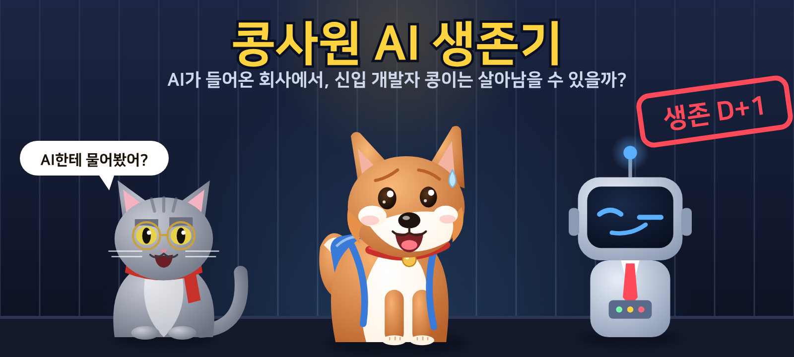
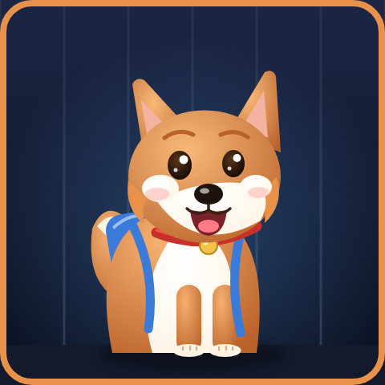
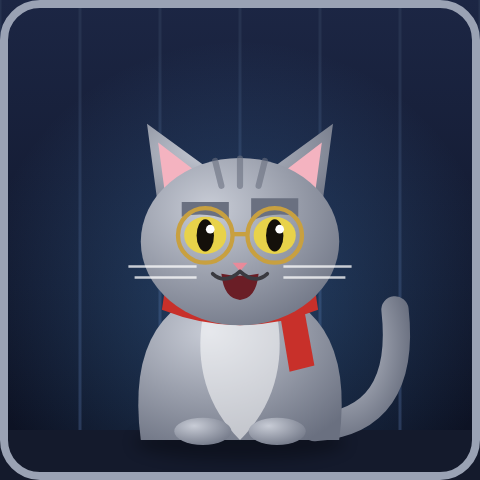
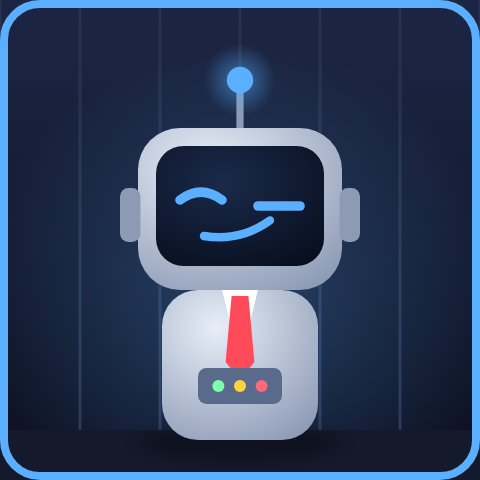
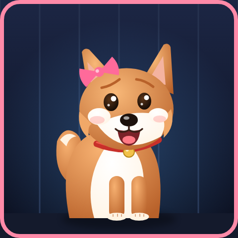
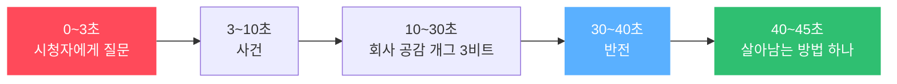
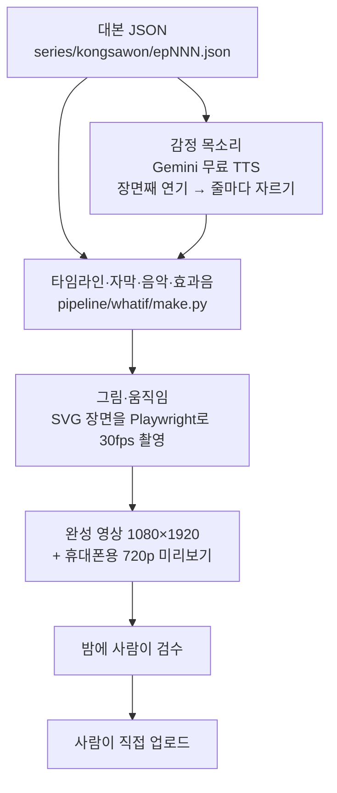

<p align="center">
  
</p>

<h1 align="center">콩사원 AI 생존기</h1>

<p align="center">
  <b>AI가 들어온 회사에서, 신입 개발자 콩이는 살아남을 수 있을까?</b><br>
  매일 45초, 동물 회사 콩트로 보는 AI 시대 직장 생존기
</p>

<p align="center">
  
  
  
  
</p>

<p align="center">
  <a href="docs/CHANNEL_PLAN.md"><b>📋 채널 기획서</b></a> ·
  <a href="#-캐릭터">캐릭터</a> ·
  <a href="#-한-편의-구조-45초">한 편의 구조</a> ·
  <a href="#-몇-년-동안-넓혀-가는-길">로드맵</a> ·
  <a href="#-만드는-방법">만드는 방법</a>
</p>

---

## 💡 어떤 채널인가요

애매한 중견기업에 AI 로봇이 "대리"로 입사합니다.
신입 개발자 시바견 **콩사원**은 AI를 숭배하는 꼰대 **냥팀장**과, 팀장 앞에서만 착한 척하는 **AI대리** 사이에서 매일 살아남아야 합니다.

- **섬뜩하게 시작해서 → 웃기고 → 살아남는 방법 하나로 끝납니다.**
- 첫 3초는 늘 보는 사람에게 묻습니다. *"신입 자리, 아직 있을까?"*
- 화면 왼쪽 위에는 `콩사원 생존 D+숫자`가 매일 하나씩 올라갑니다.
- 사람은 나오지 않습니다. Claude가 코드로 직접 그린 그림, 감정 있는 AI 목소리, 큰 자막으로 만듭니다.

> 보는 사람: 20대 후반~30대 사회초년생·주니어 직장인, 그리고 취준생

## 🐾 캐릭터

<table>
<tr>
<td align="center" width="25%"><br><b>콩사원</b><br><sub>시바견 · 신입 개발자</sub></td>
<td align="center" width="25%"><br><b>냥팀장</b><br><sub>회색 고양이 · AI 맹신 꼰대</sub></td>
<td align="center" width="25%"><br><b>AI대리</b><br><sub>로봇 · 두 얼굴의 동료</sub></td>
<td align="center" width="25%"><br><b>콩알이</b> <sub>(가안)</sub><br><sub>콩이 동생 · 취준생</sub></td>
</tr>
<tr>
<td valign="top"><sub>겉으로는 "네!", 속으로는 진심.<br><b>속마음 내레이션</b>이 웃음 포인트</sub></td>
<td valign="top"><sub>무슨 질문이든<br><b>"AI한테 물어봤어?"</b></sub></td>
<td valign="top"><sub>팀장 앞에선 천사,<br>콩이 앞에선 <b>"신입 자리, 곧 비겠네요."</b></sub></td>
<td valign="top"><sub>AI로 자소서를 쓰고,<br>AI한테 서류에서 걸러짐</sub></td>
</tr>
</table>

회사 사람은 **직급 + 동물**로 이름을 붙여서, 이름만 봐도 관계가 보이게 합니다.

## 🎬 한 편의 구조 (45초)



반전은 세 가지를 돌려 쓰고, 반응이 좋은 쪽을 늘립니다: **AI도 결국 당함** · **콩이의 한 방** · **섬뜩하게 열어둠**

## 📅 요일 코너

| 월 | 화 | 수 | 목 | 금 | 토·일 |
|:---:|:---:|:---:|:---:|:---:|:---:|
| 🏢 회사생활 | 🌱 콩이 성장 | 📝 취준 | 📰 AI 뉴스 | 💬 시청자 고민 | 자유 |
| 회의·보고·야근 | 연차가 쌓이는 본편 | 동생의 자소서·면접 | 실제 숫자 + 출처 | 좋아요 많은 고민 댓글 | 이어 보기 또는 쉼 |

## 🗺 몇 년 동안 넓혀 가는 길

| 시즌 | 콩이 | 이야기 |
|---|---|---|
| **1** · 0~3개월 | 신입 콩사원 | AI대리 입사, 회사 AI, 첫 코드리뷰, 신입 채용 감소 |
| **2** · 4~9개월 | 1년차 | 연봉 협상, 이직 고민, 동생의 AI 면접관 |
| **3** · 10~18개월 | 2년차 | 부업 시작, 사이드 프로젝트, 번아웃 |
| **4** · 19~30개월 | 3년차 | 콩대리 승진이냐 퇴사·창업이냐 |
| **5** · 3년~ | 콩대리 또는 창업가 | 동생의 신입 시즌, 새 AI 세대 |

1~10화 소재표와 1화 대본 초안은 [기획서](docs/CHANNEL_PLAN.md)에 있습니다.

## 🛠 만드는 방법



| 단계 | 도구 | 비용 |
|---|---|---|
| 그림 | Claude가 SVG로 직접 그린 캐릭터·장면 (`pipeline/whatif/art.js`, `apt.js`, `office.js`, `jobs.js`) | 0원 |
| 촬영 | Playwright(Chromium)로 `window.render(t)` 프레임 캡처, 4개 동시 | 0원 |
| 목소리 | Gemini 무료 TTS: 화자 2명 이하·5줄 이하로 묶어 한 번에 연기, Gemini Flash로 줄마다 위치를 받아 자름 (`gvoice.py`) | 0원 |
| 음악·효과음 | numpy로 직접 합성 (띵, 키보드, 심장 소리, 라이저 등 10종) | 0원 |
| 합성 | ffmpeg, 음량 -14 LUFS | 0원 |

```bash
# 길이·자막만 빠르게 확인
python pipeline/whatif/make.py <대본.json> <작업폴더> --fake-tts --no-render
# 실제 제작 (키는 환경 변수로만)
GEMINI_API_KEY=... python pipeline/whatif/make.py <대본.json> <작업폴더> --jobs 4
# README 그림 다시 굽기
node assets/readme/render.js
```

## 📁 폴더

```
docs/CHANNEL_PLAN.md     채널 기획서 (캐릭터·구조·코너·로드맵·1~10화·수익·운영)
series/kongsawon/        채널 설정 (channel.json: 캐릭터·목소리·코너·D+ 표시, episodes.json: 1~10화)
pipeline/whatif/         쇼츠 제작기 (그림 라이브러리, 화면, 목소리, 조립)
assets/readme/           README 그림과 그 원본 (art.html)
assets/fonts/            나눔 폰트 (OFL)
docs/archive/            초기 설계 문서
```

## 📏 지키는 규칙

- **유튜브 2026-07 정책**: 슬라이드쇼·템플릿 양산 없이, 매 화 새 장면과 새 대사를 만듭니다. AI가 건강·돈·법 전문가처럼 조언하지 않습니다. AI·합성 콘텐츠 표시를 붙입니다.
- **실존 회사·인물은 쓰지 않습니다.** 모든 이야기·캐릭터·대사는 새로 만든 창작물입니다.
- **숫자는 출처가 확인된 것만**, 화면에 출처를 표시합니다 (목요일 뉴스 코너).
- **무료 도구만** 씁니다. API 키는 GitHub Actions 시크릿과 실행 환경 변수에만 둡니다.
- **업로드는 사람이** 완성본을 보고 직접 합니다.

<details>
<summary><b>🧪 이전 실험 (열어 보기)</b></summary>

<br>

이 저장소는 여러 포맷을 시험하며 지금의 채널에 도착했습니다. 코드는 지우지 않고 남겨 둡니다.

| 실험 | 내용 | 위치 |
|---|---|---|
| 새벽 3시 아파트의 비밀 | 반려동물 미스터리 연재 1화 (감정 목소리, CCTV 화면, 합성 효과음) | `pipeline/whatif/a01-ep1.json`, `apt.js` |
| AI 직업 생존 판정 | 큰 모니터 스튜디오 정보형 시범 | `pipeline/whatif/j01-dev.json`, `jobs.js` |
| 만약 강아지가 말을 한다면? | 손그림 vs 3D AI 그림 비교 → 손그림으로 결정 | `pipeline/whatif/w01-*.json`, `.github/workflows/whatif-images.yml` |
| 느린 우체통 | 50~70대 사연 낭독 | `pipeline/saeyeon/` |
| 우리가 열여덟이던 겨울 | 실사형 AI 영상(Wan 2.2), 얼굴 고정, 입 모양 맞추기 | `pipeline/experiments/`, `pipeline/kaggle/`, `episodes/` |

</details>
